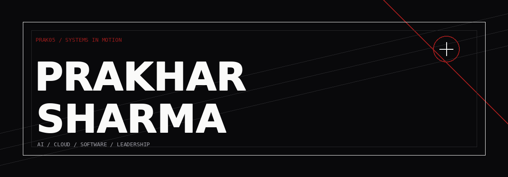
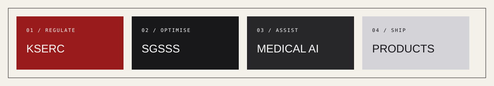

<div align="center">



<br />

<a href="https://prak05.github.io/prak05/"></a>

<a href="https://github.com/prak05"></a>
<a href="https://linkedin.com/in/prak05-btech"></a>
<a href="mailto:praksediting5@gmail.com"></a>

</div>

<div align="center">

## BUILDING SYSTEMS THAT HOLD UP

AI engineering, cloud architecture, data products, and software with a visible trail from input to outcome.

</div>



## / 01 — THE OPERATOR

I am **Prakhar Sharma**, a CSE builder from Trivandrum, Kerala. I work across applied AI, backend systems, optimisation, cloud infrastructure, and technical communities.

```text
BASE        Trivandrum, Kerala, India
STUDY       B.Tech Computer Science & Engineering
BUILD       Python · Java · C · JavaScript · SQL
SYSTEMS     FastAPI · React · Streamlit · JDBC · Docker
INTELLIGENCE RAG · computer vision · GNNs · optimisation
CLOUD       AWS · Bedrock · S3 · DynamoDB · Textract · IAM
```

## / 02 — THE WORK

<table>
<tr>
<td width="50%" valign="top">

### [KSERC](https://github.com/prak05/KSERC)

Regulatory analysis for truing-up petitions: document extraction, evidence retrieval, deterministic financial computation, and local/AWS operation.

`FASTAPI` `RAG` `TEXTRACT` `BEDROCK`

</td>
<td width="50%" valign="top">

### [SGSSS](https://github.com/prak05/SGSSS)

RCPSP optimisation with GNN-guided search, classical baselines, schedule auditing, and explainable result dashboards.

`GNN` `TABU SEARCH` `PSS` `PYTHON`

</td>
</tr>
<tr>
<td width="50%" valign="top">

### [MEDISCRIBE](https://github.com/prak05/MediScribe-2.0-clean)

Evidence-grounded medical knowledge tooling for retrieval, cited answers, and review-oriented workflows.

`RAG` `FASTAPI` `STREAMLIT`

</td>
<td width="50%" valign="top">

### [SMART IRRIGATION](https://github.com/prak05/AICTE-SMART-IRRIGATION-clean)

Crop-aware recommendations, sensor states, schedules, manual overrides, and water-use analytics.

`ML` `IOT` `STREAMLIT`

</td>
</tr>
</table>

## / 03 — THE STACK

<div align="center">


</div>

## / 04 — CURRENT VECTOR

```yaml
building:
  - grounded AI with inspectable outputs
  - local-first software with an AWS path
  - interfaces that make complex work legible

learning:
  - MLOps and cloud-native architecture
  - cybersecurity and systems reliability
  - technical leadership and product communication

open_to:
  - AI/ML engineering
  - applied research
  - open-source collaboration
```

## / 05 — RECEIPTS

| YEAR | SIGNAL |
|---:|---|
| 2023 | Prime Minister's Pariksha Pe Charcha recognition |
| 2024 | IEEE Human vs AI debate — second position |
| 2024 | Linux and ethical-AI guidance through Vidya Sadhnam |
| 2016–2024 | Student council and technical community leadership |

<div align="center">

<br />

**[ALL REPOSITORIES →](https://github.com/prak05?tab=repositories)**

<br /><br />


</div>
