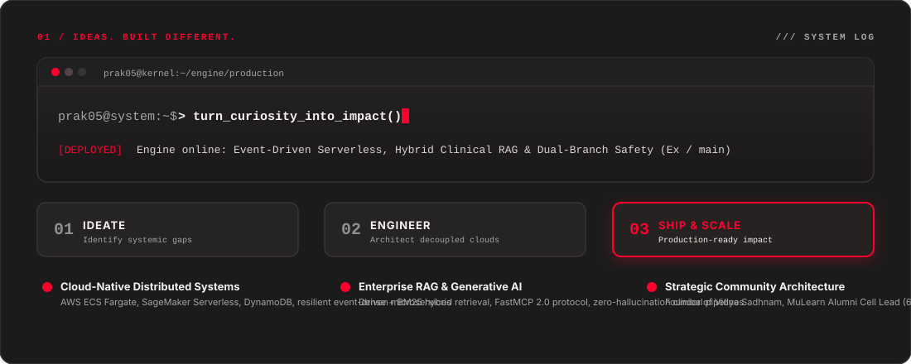
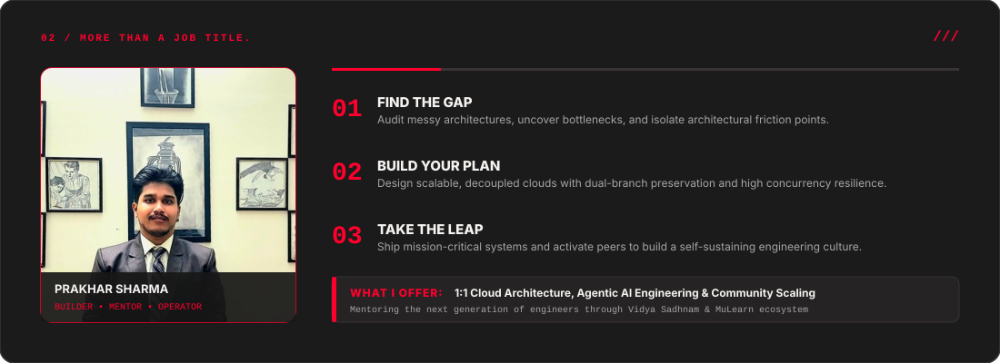
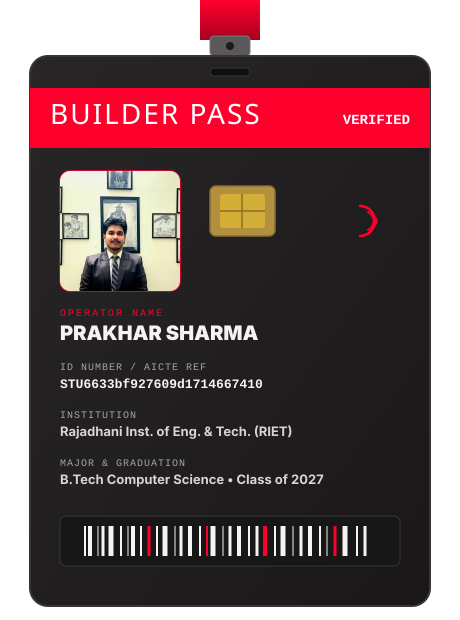
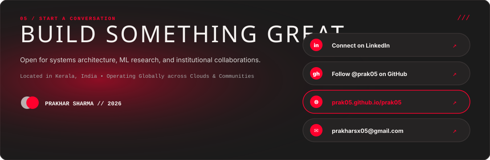

<!-- 00 / HERO CINEMATIC BANNER -->

  

<!-- TOP INTERACTIVE LAUNCH PADS -->

  
  &nbsp;&nbsp;
  
  &nbsp;&nbsp;
  

---

<!-- 01 / IDEAS. BUILT DIFFERENT. -->

  

 

<!-- 02 / MORE THAN A JOB TITLE. -->

  

 

<!-- 03 / MY ENGINE ROOM -->

  

 

---

<!-- 05 / SELECTED ENGINEERING (THINGS I'VE BUILT) -->

  <h2>⚡ THINGS I'VE BUILT // SELECTED ENGINEERING</h2>
  
Mission-critical distributed architectures, clinician-first RAG engines, and predictive ML systems.

<table width="100%" border="0" cellspacing="0" cellpadding="8">
  <thead>
    <tr bgcolor="#252323">
      <th align="left" width="28%">PROJECT</th>
      <th align="left" width="52%">WHAT IT DOES // TECHNICAL ARCHITECTURE</th>
      <th align="center" width="20%">FOCUS</th>
    </tr>
  </thead>
  <tbody>
    <tr bgcolor="#1b1b1b">
      <td valign="top">
        <b><a href="https://github.com/prak05/OmniPrice-ML-Engine">OmniPrice ML Engine</a></b> 
        Autonomous Pricing Forecasting
      </td>
      <td valign="top">
        High-dimensional price elasticity and revenue forecasting engine with sub-40ms P99 inference. Distributed feature store on AWS S3 &amp; SageMaker Serverless.
      </td>
      <td align="center" valign="middle">
        <code>MLOps / Cloud</code>
      </td>
    </tr>
    <tr bgcolor="#202020">
      <td valign="top">
        <b><a href="https://github.com/prak05/MediScribe-AI-Platform">MediScribe AI Platform</a></b> 
        Ambient Clinical Scribe
      </td>
      <td valign="top">
        Speech-to-EHR transcription pipeline generating structured SOAP notes with zero hallucination. Integrated with AWS Transcribe Medical &amp; Claude 3.5 Sonnet.
      </td>
      <td align="center" valign="middle">
        <code>Clinical GenAI</code>
      </td>
    </tr>
    <tr bgcolor="#1b1b1b">
      <td valign="top">
        <b><a href="https://github.com/prak05/MedBuddy-Clinical-RAG">MedBuddy Clinical RAG</a></b> 
        UST SIGHT 3.0 &amp; Ideathon Winner
      </td>
      <td valign="top">
        Hybrid dense + BM25 medical guideline retrieval platform. Honored at <b>Gravity | IEDC-MCET Ideathon</b> and nationally recognized at <b>UST SIGHT 3.0</b>.
      </td>
      <td align="center" valign="middle">
        <code>Hybrid RAG</code>
      </td>
    </tr>
    <tr bgcolor="#202020">
      <td valign="top">
        <b><a href="https://github.com/prak05/AgriSmart-Precision-Irrigation">Agri-Smart Pro</a></b> 
        National Top 1.1% Finalist
      </td>
      <td valign="top">
        Multi-parcel automated irrigation system using <code>MultiOutputClassifier</code> (RandomForest). Selected in national <b>Top 40 out of 3,668 teams</b> (AICTE / Shell India).
      </td>
      <td align="center" valign="middle">
        <code>IoT &amp; Predictive ML</code>
      </td>
    </tr>
    <tr bgcolor="#1b1b1b">
      <td valign="top">
        <b><a href="https://github.com/prak05/EDUNET-AI-CLOUD-FASAL-SAARTHU-KUSHAL-KISAN">Fasal Saarthi: Kushal Kisan</a></b> 
        IBM Watsonx AutoAI Platform
      </td>
      <td valign="top">
        7-parameter crop recommendation engine (N, P, K, pH, temp, humidity, rainfall) with 95%+ confidence. Multi-language REST endpoints (Python, Java, JS).
      </td>
      <td align="center" valign="middle">
        <code>AutoAI / Cloud</code>
      </td>
    </tr>
    <tr bgcolor="#202020">
      <td valign="top">
        <b><a href="https://github.com/prak05/KSERC">KSERC Regulatory Audit Tool</a></b> 
        Govt. Statutory Tariff Engine
      </td>
      <td valign="top">
        Formal MoU research initiative with Kerala State Electricity Regulatory Commission automating multi-year petition truing-up using Textract and Bedrock.
      </td>
      <td align="center" valign="middle">
        <code>GovTech / NLP</code>
      </td>
    </tr>
  </tbody>
</table>

 

---

<!-- 04 / BUILDER CREDENTIALS & REAL WORK -->
<table width="100%" border="0" cellspacing="0" cellpadding="8">
  <tr>
    <td width="42%" valign="top">
      
    </td>
    <td width="58%" valign="top">
      
    </td>
  </tr>
</table>

 

---

<!-- VERIFIED FIELD LEADERSHIP & HONORS -->

  <h2>🏛️ VERIFIED FIELD JOURNEY &amp; INSTITUTIONAL IMPACT</h2>

<table width="100%" border="0" cellspacing="0" cellpadding="10">
  <tr bgcolor="#252323">
    <td width="50%" valign="top">
      <h3>⚡ Professional &amp; Statutory Appointments</h3>
      <ul>
        <li><b>Kerala State Electricity Regulatory Commission (KSERC)</b>: Appointed intern under signed MoU between KSERC Board and RIET. Built the automated truing-up financial audit tool.</li>
        <li><b>MuLearn Foundation</b>: Partner Engagement Intern driving strategic student developer ecosystems and state-wide network initiatives.</li>
        <li><b>Alumni Cell Lead, µLearn RIET</b>: Directing mentorship pipelines connecting 600+ engineers with industry veterans across Kerala.</li>
        <li><b>AWS Student Builder Group Leader (SBGL)</b>: Directed the 4-day CloudCraft GenAI bootcamp onboarding 150+ engineers to AWS.</li>
        <li><b>Edunet Foundation / IBM SkillsBuild / AICTE</b>: AI Cloud Developer Intern for Fasal Saarthi and AgriSmart Pro.</li>
        <li><b>VirtuNexa &amp; AND Intern</b>: Mobile application systems &amp; ML fraud detection models.</li>
      </ul>
    </td>
    <td width="50%" valign="top">
      <h3>🏆 Distinctions, Summits &amp; Alliances</h3>
      <ul>
        <li><b>IEEE Techventure 2.0 Debate Winner</b>: Champion at IEEE CS SBC LBSITW alongside Akhil Kv &amp; Adithya Baiju.</li>
        <li><b>Gravity | IEDC-MCET Cluster Ideathon</b>: 1st Place for MedBuddy Healthcare AI Assistant.</li>
        <li><b>National Top 1.1% Finalist</b>: Ranked in Top 40 out of 3,668 developers in AICTE-Shell India Skills4Future.</li>
        <li><b>UST SIGHT 3.0 National Showcase</b>: Advanced MediScribe AI to national healthcare innovation expo.</li>
        <li><b>Vidya Sadhnam Developer Culture</b>: Founder of campus initiative running high-intensity sprints (<i>GitHub Geeks</i> &amp; <i>Data Manipulators</i>).</li>
        <li><b>Classical Veena Musician</b>: Performed for the Chief of Western Air Command; guided by discipline, adaptability and duty-driven action.</li>
      </ul>
    </td>
  </tr>
</table>

 

<!-- 05 / START A CONVERSATION -->

  

 

---

<!-- 06 / FOOTER -->

  
    <b>PRAKHAR SHARMA</b> • Operating from Kerala, India • B.Tech CSE Class of 2027 • 
    <a href="https://prak05.github.io/prak05/">Live Web Portfolio</a> • 
    <a href="https://github.com/prak05">GitHub</a> • 
    <a href="mailto:prakharsx05@gmail.com">Email</a>
  

Architected with extreme precision • Powered by Dark Charcoal &amp; Hot Red Editorial Bento • Safe Dual-Branch Mesh (Ex / main)

